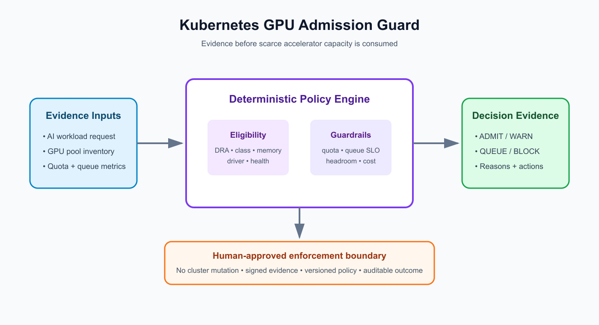

# Kubernetes GPU Admission Guard

A deterministic, advisory admission gate for AI workloads competing for scarce Kubernetes GPU capacity. It evaluates DeviceClass policy, Dynamic Resource Allocation (DRA) use, tenant quota, device health, memory fit, queue SLO, capacity headroom, and unit cost before returning `ADMIT`, `WARN`, `QUEUE`, or `BLOCK` evidence.



## Production problem

GPU workloads can be syntactically valid yet operationally unsafe to admit. A job may exceed tenant quota, request an unmanaged accelerator class, depend on an unhealthy driver, breach its maximum start delay, or consume the last headroom in an expensive pool. The result is pending pods, noisy escalations, poor utilization, and unpredictable platform cost.

This project gives platform teams a reviewable decision before connecting admission evidence to Kueue, a policy controller, GitOps, or a human-approved provisioning workflow. It deliberately makes no cluster or cloud mutations.

## Why this is in demand now

Live AI-infrastructure and platform roles repeatedly ask for Kubernetes, GPU scheduling, Slurm/Kueue-style orchestration, Terraform, observability, multi-tenant isolation, quotas, SLOs, and Python or Go automation. Examples reviewed on 2026-10-21 include:

- [Deepgram — Platform Engineer, AI/ML Infrastructure](https://jobs.ashbyhq.com/Deepgram/f424ef6a-c27f-4984-9e77-40a1ad16ae28/): remote US; Kubernetes, Terraform, Slurm, GPU orchestration, developer tooling, and FinOps.
- [STN — Senior Platform Engineer](https://jobs.ashbyhq.com/stninc/e7ce03c6-470a-4d9f-a45b-3bae8861ddb6): remote US; multi-tenant GPU orchestration, quotas, GPU Operator, observability, SLOs, and APIs.
- [fal — Senior/Staff Kubernetes Infrastructure Engineer](https://jobs.ashbyhq.com/fal-ai/d9384b0a-2f86-4e9a-bcc7-5b49f1c0b081): remote US; high-performance inference, orchestration, observability, Kubernetes, Slurm, storage, and networking.

Authoritative design references:

- [Kubernetes Dynamic Resource Allocation](https://kubernetes.io/docs/concepts/resource-management/dynamic-resource-allocation/) defines DeviceClasses and ResourceClaims for attached accelerators.
- [Kubernetes GPU scheduling](https://kubernetes.io/docs/tasks/manage-gpus/scheduling-gpus/) documents device-plugin resource requests and their constraints.
- [Kubernetes DRA hardening](https://kubernetes.io/docs/concepts/security/hardening-guide/dynamic-resource-allocation/) emphasizes granular, least-privilege status authorization.
- [NVIDIA GPU Operator](https://docs.nvidia.com/datacenter/cloud-native/gpu-operator/latest/) automates drivers, the device plugin, node labeling, and DCGM monitoring.

## Architecture and decision flow

1. A read-only collector produces a bounded JSON snapshot of the workload, tenant quota, GPU pools, and metrics.
2. The engine filters nodes by driver/device health, DeviceClass, and GPU memory.
3. Policy checks DRA use, allowed classes, tenant quota, queue SLO, headroom, cost, and DCGM error rate.
4. The engine returns stable reason codes, recommended actions, placement evidence, and a deterministic fingerprint.
5. A human or separately authenticated controller decides whether to enforce the result.

## Run and test

```bash
python -m venv .venv
source .venv/bin/activate
python -m pip install -e .
python -m kubernetes_gpu_admission_guard --input examples/cluster-snapshot.json
python -m unittest discover -s tests -v
```

Docker:

```bash
docker build -t kubernetes-gpu-admission-guard .
docker run --rm kubernetes-gpu-admission-guard
```

## Tests and measurable outcomes

The test suite covers healthy admission, missing evidence, quota exhaustion, DRA enforcement, class policy, capacity queuing, queue-SLO breach, unhealthy nodes, low headroom, DCGM errors, and deterministic fingerprints.

Teams can evaluate the guard using:

- percentage of unschedulable GPU jobs detected before submission;
- p95 GPU job start delay and queue-SLO breach rate;
- quota-policy coverage and false-block rate;
- accelerator utilization and reserved headroom;
- cost per admitted GPU-hour;
- mean time to explain a pending AI workload.

## Security and failure modes

- Use read-only identities for inventory and telemetry collection.
- Treat snapshots as untrusted input; validate and cap their size before production use.
- Keep mutation credentials outside the guard and require approval for capacity changes.
- Sign evidence and policy versions when decisions gate deployments.
- Apply least-privilege RBAC to ResourceClaim and ResourceSlice status operations.
- Fail closed when required evidence is missing, but distinguish temporary capacity queuing from policy violations.
- Do not trust a healthy Kubernetes node alone: include device-driver and DCGM evidence.

## Deployment guidance

The included CronJob is a hardened audit-only example. Replace its image, mount an evidence source, pin the image digest, and send results to an immutable store. For admission integration, put this engine behind a controller that has no mutation permission; pass its signed result to a separate policy or approval system. Test with shadow decisions before enforcement and measure false blocks.

## Interview positioning

Use this project to discuss why AI platform engineering is more than installing a GPU operator. Explain the difference between device availability and workload admissibility, how DRA and DeviceClasses improve governance, why quota and queue SLOs belong in the same decision, how deterministic evidence keeps AI-infrastructure automation auditable, and where you intentionally placed the human approval boundary.
